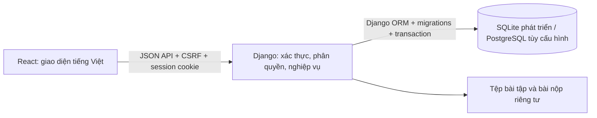

# Phạm vi triển khai và đối chiếu tài liệu

## Kiến trúc

- `frontend/src/`: React, CSS, biểu mẫu lấy metadata từ API; không chứa kết nối CSDL hay mật khẩu.
- `academy/models.py`: mô hình dữ liệu, FK, kiểu và ràng buộc.
- `academy/services.py`: giới hạn phạm vi dữ liệu, sinh lịch; `academy/views.py`: API, xác thực và giao dịch.
- `config/`: cấu hình runtime; `academy/migrations/`: cấu trúc CSDL tái tạo được.

## Đã có trong bản phát triển

| Nhóm | Luồng triển khai |
|---|---|
| Tài khoản | Đăng nhập/đăng xuất, ghi nhớ, đổi lần đầu, đổi mật khẩu, quên/đặt lại bằng OTP email; thêm/sửa/xem/tìm tài khoản theo quyền; nhập nhiều tài khoản CSV theo giao dịch; Active/Inactive |
| Khóa/ca/lớp/lịch | CRUD, tìm kiếm, danh sách, lưu trữ/khôi phục; ràng buộc giờ/ngày; phòng nạp sẵn; thêm/rời lớp và giữ lịch sử; sinh buổi theo thứ trong tuần; kiểm tra trùng phòng/lớp/GV |
| Bài tập | Nội dung tạo một lần; giao cho từng lớp với buổi/hạn riêng; giao nhiều lớp qua popup chọn lớp/buổi/hạn riêng hoặc CSV giao dịch; chỉnh sửa/xóa mềm; đính kèm PDF/DOCX/JPEG/PNG, tối đa 20 MB |
| Bài nộp | HV xem nội dung được giao, nộp văn bản và tệp, hủy trước hạn; nộp muộn được ghi nhận riêng; theo dõi cả người chưa nộp/quá hạn; GV tạo/sửa/xóa nhận xét và ghi ngoại lệ |
| Điểm | GV thêm/sửa/xóa/nhập hàng loạt; loại kiểm tra đầu vào/giữa/cuối khóa; thang 0–10, bước 0.5; Overall tính bằng Decimal; lịch sử thay đổi |
| Dữ liệu học tập | Tổng quan điểm, nhận xét, trạng thái nộp bài, tìm kiếm; HV gửi yêu cầu học lại; QLLH/QLCN duyệt/từ chối có lý do và snapshot tiêu chí |

Các màn hình dùng chung bảng/biểu mẫu có metadata, chưa tái tạo riêng mọi wireframe của PDF. Dữ liệu và thao tác gọi API thật, không dùng mảng giả tại frontend. Thiết kế màu và bố cục theo PDF; banner trang chủ được dựng bằng CSS, không sao chép ảnh quảng cáo.

## Quyền và phạm vi

- QLCN: quản lý khóa/ca/lớp/lịch; tạo QLLH/GV; tài khoản HV không xuất hiện trong danh sách tài khoản của QLCN theo AC. Xem dữ liệu học tập và duyệt học lại toàn trung tâm.
- QLLH: quản lý lớp mình phụ trách, tạo HV; đọc HV do mình tạo hoặc thuộc lớp mình; chỉ gán chính mình làm quản lý khi tạo lớp.
- GV: đọc lớp được phân công; quản lý bài tập mình tạo, điểm/bài nộp/nhận xét của lớp mình.
- HV: chỉ đọc lớp đang/đã tham gia và dữ liệu học tập của mình; chỉ nộp cho enrollment của chính mình; không có quyền sửa điểm hoặc duyệt học lại.
- Django superuser phục vụ vận hành, có quyền rộng. Không dùng superuser làm tài khoản nghiệp vụ thông thường.

## Quyết định khi tài liệu có mâu thuẫn

1. Danh sách chức năng mới của người dùng xác định phạm vi. Không thêm màn hình điểm danh hay lịch sử truy cập; vẫn giữ log phục vụ truy vết.
2. Dùng mã QLCN/QLLH/GV/HV + số tăng, không tái dùng. Khóa/lớp dùng ký hiệu khóa + số tăng. Có khóa giao dịch trên bộ đếm; cần kiểm thử tải cạnh tranh trên PostgreSQL trước production.
3. Điểm 0–10 theo tài liệu 3NF, bước 0.5; không áp dụng trần IELTS 9 khi chưa được chốt. Overall trung bình bốn kỹ năng và làm tròn nửa điểm, điểm giữa làm tròn lên.
4. Tách Assignment/Allocation: nhiều lớp dùng cùng nội dung bài tập; mỗi lớp có buổi/hạn nộp riêng.
5. Sửa lịch giữ ID buổi học, đánh dấu hủy buổi tương lai bị bỏ; không xóa rồi sinh lại buổi có liên kết. Buổi quá khứ giữ phòng lịch sử. Số buổi mới tiếp tục tăng, không đổi ID/số của buổi cũ.
6. Lưu trữ tách xóa mềm. Khóa/ca/lớp đang được dùng bị chặn xóa, có thể lưu trữ. Lịch có bài tập gắn vào buổi bị chặn xóa; lịch chưa có bài tập được xóa mềm và hủy các buổi tương lai. Bài tập/điểm dùng xóa mềm; nhận xét xóa cứng kèm log. HV rời lớp không mất điểm/bài nộp.
7. Quyền thêm nhận xét được giữ vì chức năng sửa/xóa cần có luồng tạo.
8. Yêu cầu học lại do quản lý quyết định, bắt buộc ghi lý do. Hệ thống chụp điểm và tỷ lệ nộp cho từng tiêu chí tham khảo, không tự bịa dữ liệu nghỉ học.
9. Không lưu mật khẩu tạm có thể giải mã lâu dài như một đề xuất trong tài liệu. Chỉ trả một lần khi tạo; người tạo phải lưu/gửi riêng. Mật khẩu trong CSDL băm Argon2.
10. OTP băm, hạn 5 phút, tối đa 5 lần thử, gửi lại vô hiệu mã cũ. Đổi/reset mật khẩu hủy các phiên đang tồn tại. Có giới hạn yêu cầu 15 phút; chưa dùng Redis/distributed rate limit.

## Khác biệt và phần chưa nghiệm thu

- Nhập/xuất CSV UTF-8 thay vì Excel XLSX; xuất dữ liệu trang hiện tại và có thông báo. CSV dùng ID khóa ngoại, xem ID trong popup chi tiết; loại kiểm tra/phòng nạp sẵn. Chưa có wizard import Excel có preview/mapping.
- Giao nhiều lớp có popup chọn các lớp, buổi và hạn nộp riêng; có thể dùng CSV khi số lượng lớn. Thiết kế popup bám cấu trúc wireframe nhưng chưa so khớp pixel.
- Tìm kiếm chuỗi, phân trang 10 dòng; lọc trạng thái và khóa ngoại (khóa học/lớp/GV/loại bài kiểm tra…) phía server. Chưa có bộ lọc khoảng ngày và sắp xếp từng cột. Tìm kiếm hiện quét dữ liệu trong phạm vi quyền; cần tối ưu ORM khi dữ liệu lớn.
- Thông tin học tập tổng quan giới hạn 100 điểm và 100 nhận xét mới nhất; danh sách riêng có phân trang. Lịch gần nhất tối đa 12 buổi.
- Màn hình chi tiết lớp gồm thông tin lớp, thành viên và các buổi học; điểm có màn hình riêng với bộ lọc enrollment, chưa gộp tab điểm vào chi tiết lớp.
- Lưu trữ loại khỏi danh sách mặc định, chặn tạo/sửa dữ liệu học tập cho lớp/khóa đã lưu trữ. Cần chốt với BA cách xử lý toàn bộ bài giao còn hạn và email thông báo khi lưu trữ.
- Ngoại lệ hiện hỗ trợ công nhận/không hợp lệ và ghi lý do/trạng thái trước, chưa có tệp minh chứng riêng hoặc điều chỉnh thời gian nộp. Thành viên đã rời lớp có thao tác tham gia lại, giữ nguyên khóa enrollment và lịch sử.
- Chỉ hỗ trợ DOCX hiện đại; chưa nhận DOC cũ. Kiểm tra magic bytes/cấu trúc DOCX, chưa có antivirus hay xử lý tài liệu nền. HTML mô tả được hiển thị như văn bản để tránh thực thi HTML không tin cậy; chưa có rich-text editor.
- SMTP mặc định ghi thư vào `var/mail/`, chỉ dùng phát triển. Gửi mail thực cần cấu hình riêng. Tài khoản mới chưa tự gửi thư mời.
- CSDL chạy thực đã kiểm thử là SQLite. PostgreSQL có driver/cấu hình, chưa có server PostgreSQL ở phiên này để chạy cùng suite. Chưa kiểm thử hiệu năng, backup/restore, đa chi nhánh hay triển khai công khai.

Các giới hạn trên cần hoàn thiện/đối chiếu AC trước khi gọi đây là bản nghiệm thu toàn bộ hoặc production-ready.
